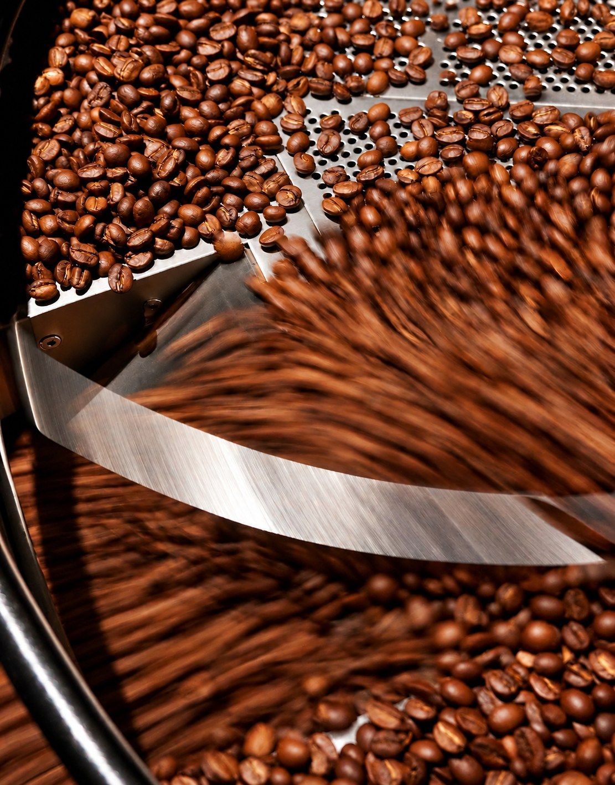
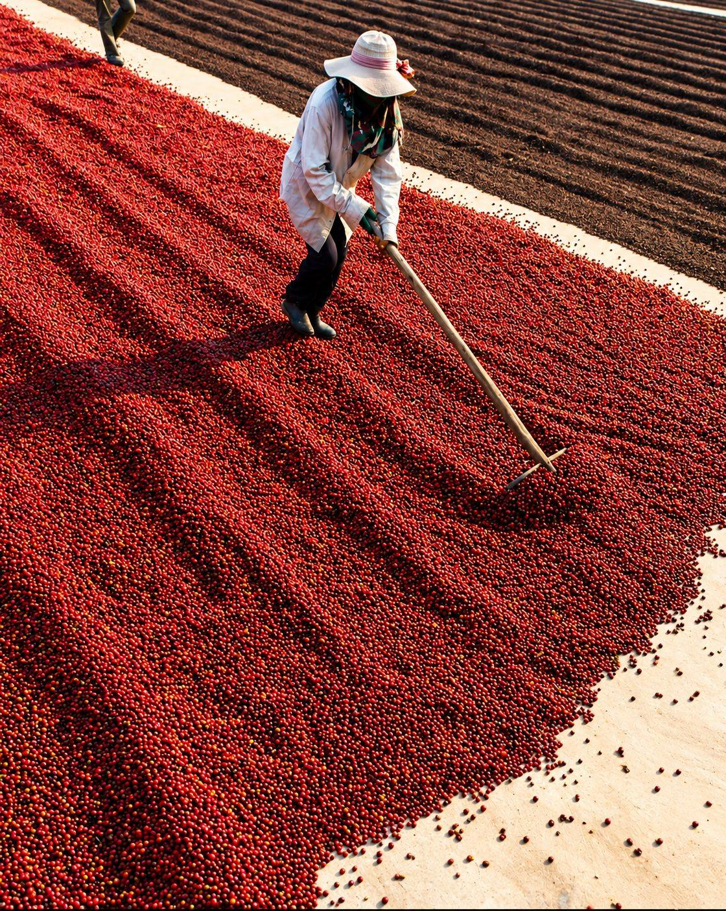
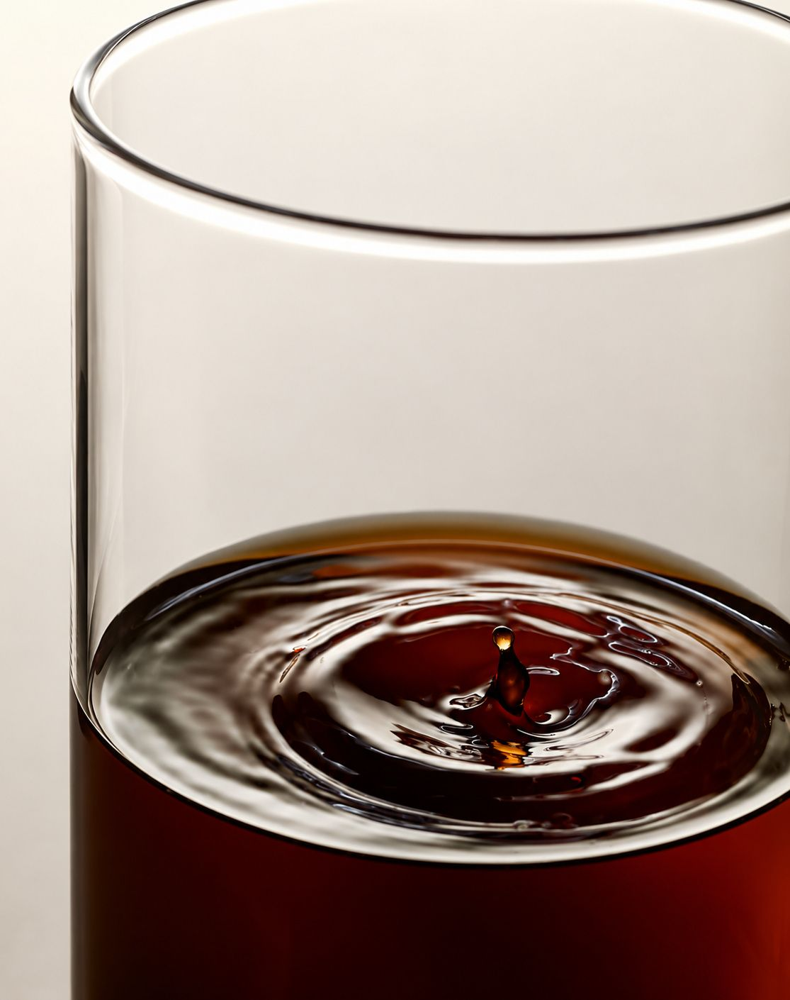
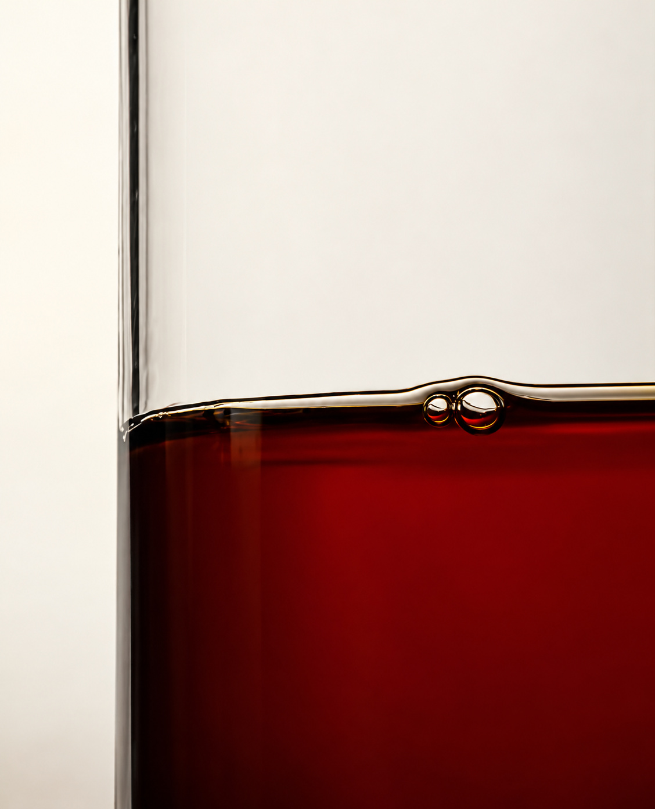

Light roast keeps more of what a coffee tasted like before it was roasted: fruit, flowers and a bright acidity. Dark roast trades those for the flavor of the roast itself, more bitter, with notes of bittersweet chocolate, toast or smoke. Neither has meaningfully more caffeine.

{roast-chart}

## What roasting changes

Green coffee is pale, hard and grassy. Heat browns it, builds sweetness and aroma, and drives out water.

Two sounds mark the way. **First crack** is a popping, like popcorn, as steam breaks the bean open; light roasts end soon after it. **Second crack** is quieter and quicker, as the bean's structure starts to break down and oils rise to the surface; dark roasts go into it.

The longer a coffee roasts, the more its own flavors give way to the roast's. That's why two dark roasts from different countries can taste alike, and two light roasts rarely do.

There's no fixed line between light, medium and dark: one roaster's medium can look like another's light.

## Where the flavor comes from

Much of a coffee's flavor is set before it reaches a roaster, by its variety, where it grew and how it was processed. Our two Ayla Bombe coffees show it. They come from the same farm and the same varieties; one was dried in the cherry and one was washed. The Natural tastes of mango and strawberry, the Washed of blueberry, lemon zest and jasmine. Both are light filter roasts, and they taste very different.

Tap a region to see where ours grow.

{coffee-map}

## Does dark roast mean stronger coffee?

"Strong" can mean three things:

- **Flavor:** dark roast tastes more roasted and bitter.
- **Concentration:** more coffee for the same water makes a stronger cup, whatever the roast.
- **Caffeine:** about the same by weight. Light beans are denser, so a scoop of them holds slightly more coffee.

If your cup tastes thin, use more coffee before you reach for a darker roast.

## Is light roast more acidic?

It tastes brighter. Light roasts keep more of a coffee's fruit acids, which fade as a roast darkens. That brightness should come with sweetness: if a light roast tastes sharply sour or thin, it's the brew that needs adjusting, not the coffee.

## How to brew light roast coffee

These are the recipes on each of our coffees' pages.

| Pour over | |
| --- | --- |
| Coffee | 15g |
| Water | 250g |
| Temperature | 94°C (201°F) |
| Grind | Medium-fine, like table salt |
| Time | About 3 minutes |

Bloom with 40g of water for 30 seconds, then pour the rest slowly in circles.

| Espresso | |
| --- | --- |
| Dose | 18g |
| Yield | 40g |
| Time | 28–32 seconds |
| Temperature | 93°C (199°F) |

Then change one thing at a time:

- **Sour and thin?** Grind finer, or use hotter water.
- **Bitter and drying?** Grind coarser.
- **A pour over that's too intense?** Add a little hot water to the cup.

If you're coming from a darker espresso, don't reuse its settings. Light roasts usually want a finer grind and a longer shot.

## Filter roast and espresso roast

We roast every coffee light, for one of two kinds of brewing.

|  | Filter roast | Espresso roast |
| --- | --- | --- |
| Brewers | Pour over, drip, AeroPress, French press | Espresso machine, milk drinks |
| Aim | Clarity and an expressive cup | Sweetness and balance under pressure |
| Ours | Ayla Bombe Washed, Muhathi Estate, Finca La Asunta | San Antonio, Sao Judas Tadeu, House Blend |

## If you usually drink dark roast

Light roast doesn't have to taste like fruit juice. Start with a coffee whose notes sound familiar: Sao Judas Tadeu tastes of dark chocolate and walnut, San Antonio of caramel, red apple and cocoa.

{coffee:san-antonio}

When you want more fruit, try Ayla Bombe Washed.

{coffee:ayla-bombe-washed}

Or take the [Find Your Coffee](find-your-coffee) quiz.

## Why we roast light

We roast light, in Los Angeles, so the differences between coffees stay easy to taste: far enough to be sweet, and no further. More in [True Specialty](true-specialty).

## Light vs. dark roast FAQ

### Can you use light roast for espresso?

Yes. Espresso is a way of brewing, not a roast level, and several of our coffees are roasted light for espresso.

### How long should light roast coffee rest?

About a week after roasting. Ours taste best from one to five weeks after roasting; for espresso, give them at least 7 to 10 days.
