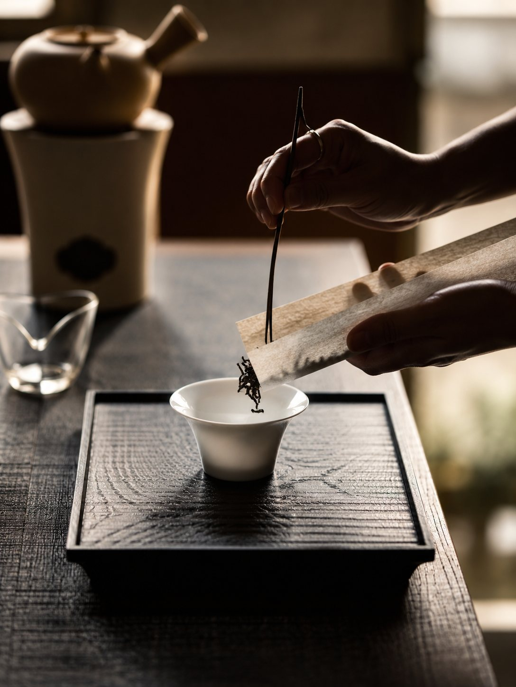
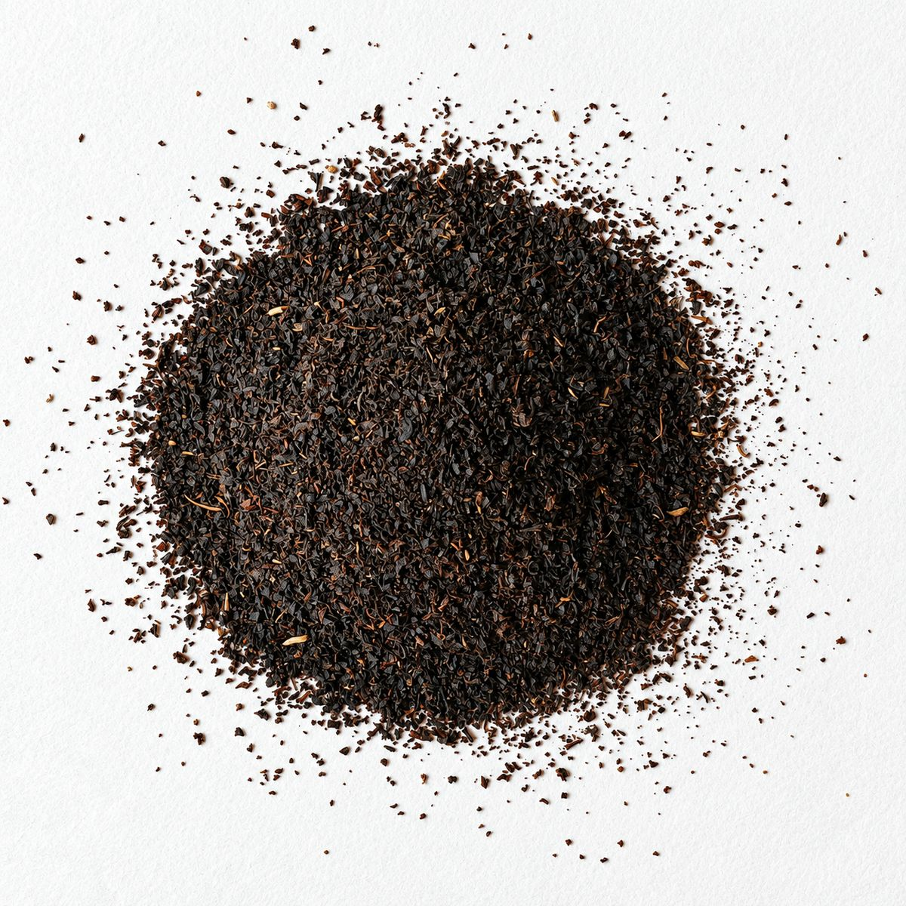
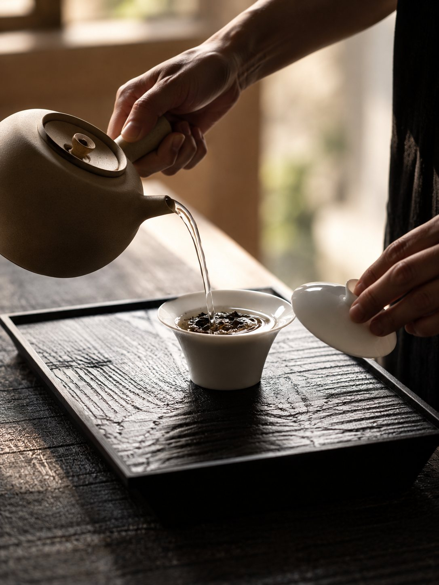
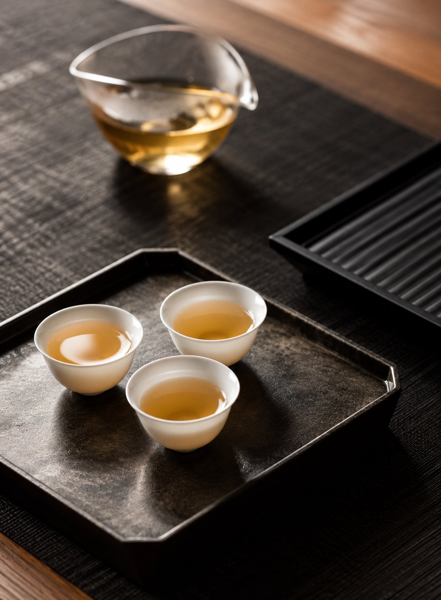

All tea comes from one plant, *Camellia sinensis*. A cultivar is one named strain of that plant, the way Chardonnay is one kind of grape. Yabukita and Tie Guan Yin are cultivars, and two teas made the same way can taste quite different because they came from different ones.

## Clonal and seed-grown tea

A cultivar starts as a bush a grower wanted more of: one with a sweeter leaf, a stronger aroma, a bigger harvest, or one that came through a cold winter. There are two ways to grow more of it.

|  | Clonal | Seed-grown |
| --- | --- | --- |
| Grown from | Cuttings of one bush | Seeds |
| Each bush | Identical to the parent | A little different from the next |
| In the cup | The same character year to year | More variation |
| Examples | Yabukita, Sijichun, AV2 | Hadong, Assam Jat |

Clonal bushes all bud, grow and taste alike, which makes them easier to farm. Seed-grown gardens, like Korea's Hadong or Assam's old jat gardens, vary from bush to bush, and many drinkers find their tea more layered.

## Tea cultivar vs. tea type

Tea type, such as green, oolong or black, is how the leaf is processed. The cultivar is which plant it came from. One cultivar can make several types: Sayama Kaori is made into both green and black tea, and Zi Ya into anything from green tea to puerh.

{tea-types}

Some names are both. Tie Guan Yin is a cultivar and also the oolong made from it. Da Hong Pao is a style named after a few famous bushes in the Wuyi Mountains; most Da Hong Pao today is a blend of several Wuyi cultivars.

## Tea cultivars worth knowing

### Japan

- **Yabukita:** the most planted, registered in 1953. Its balanced sencha is the taste every other Japanese cultivar is compared with.
- **Saemidori:** Yabukita crossed with Asatsuyu, for vivid green color and strong umami. Common in competition sencha.
- **Okumidori:** late budding, mild and rounded. Often blended to soften brighter cultivars.
- **Samidori and Gokoh:** Uji cultivars for gyokuro and matcha, with little bitterness and a thick, sweet body.

### China

- **Tie Guan Yin:** Anxi's oolong cultivar, about 300 years old. Kept fresh and green or roasted dark, it makes two very different teas.
- **Rou Gui and Shui Xian:** mainstays of Wuyi rock tea. Rou Gui is named for its cinnamon-like aroma; old Shui Xian bushes give mossy, orchid and woodsmoke notes.
- **Da Bai and Da Hao:** the large-leaf, silver-haired cultivars behind Silver Needle and White Peony.
- **Longjing #43:** bred for Dragon Well, with early buds and the flat, spear-shaped leaf the tea is known for.

### Taiwan

- **Qing Xin:** the heirloom behind high mountain oolong, Dong Ding and Bao Zhong. Slow growing, with more depth.
- **Sijichun:** a 1980s hybrid harvested year-round. Creamy and easy, a good first Taiwanese oolong.

### Korea, India and Sri Lanka

- **Hadong:** the seed-grown tea of Korea's Jiri Mountains, the country's oldest tea region.
- **AV2:** a Darjeeling clone known for its intense muscatel in first-flush tea.
- **Assam Jat:** Assam's traditional seed-grown tea, of the large-leaf variety *assamica*.
- **Assamica in Sri Lanka:** the large-leaf tea behind the malty, full-bodied style of low-grown Ceylon black tea.

## Every tea cultivar, by country

Tap a region to see what grows there, or search the table.

{tea-map}

{cultivars}

## How to find the cultivar on a label

Teas made from one cultivar usually say so. A Japanese sencha may be sold by its cultivar, such as Saemidori or Okumidori, and Taiwanese oolongs often name Qing Xin or Sijichun. If a label gives only the type and the region, the tea is most likely a blend of cultivars.

## How to taste the difference

Pick two teas of the same type but different cultivars, like a Yabukita sencha and a Saemidori sencha. Brew them side by side with the same amount of leaf, the same water and the same time, then taste them as they cool. The Yabukita is the familiar, balanced sencha; the Saemidori should look greener and taste richer in umami.

## Our teas

Our Mei is a Japanese black tea blend. Its black tea is Yabukita, with burdock root, kuromoji, roasted tea and shiso leaves alongside.

{tea:mei}

Khan is an herbal tea of ho wood, citrus peel and kuromoji leaves. It isn't from the tea plant, so it has no tea cultivar and no caffeine.

{tea:khan}

Take the [Find Your Tea](find-your-tea) quiz, or shop [all our teas](tea).

## Tea cultivar FAQ

### What is the most common Japanese tea cultivar?

Yabukita. It still covers well over half of Japan's tea fields, though its share has been falling as newer cultivars are planted.

### Is Assam a cultivar?

No. Assam is a region, and most of its tea is the large-leaf variety *assamica*, which takes in many cultivars and seed-grown types. Japan grows the small-leaf variety, *sinensis*.

### Do herbal teas have cultivars?

Not tea cultivars. Herbal teas are made from other plants, such as wood, peel, roots and leaves, not *Camellia sinensis*.
